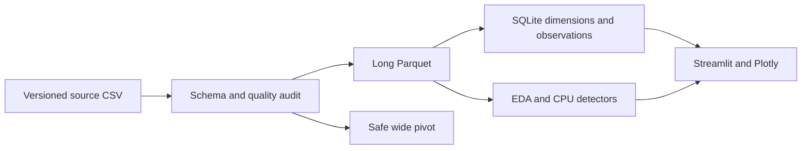

# Architecture
Python 3.12, Streamlit, Plotly, SQLite. CSV is streamed in chunks; bounded source or deterministic monthly windows support CPU demos. Long Parquet preserves sensor observations; wide Parquet supports within-well analysis. Immutable artifacts are prepared by CLI, not app imports. SQLite supports local analytical queries and later review persistence. No separate frontend/backend is necessary for this single-user offline workflow.

Phase 2.5: immutable main event CSV → idempotent `events.ingest` → separate persistent review SQLite (analysis_runs/events/event_runs/alert_reviews). This preserves analyst work across observation snapshot rebuilds. `characterize` produces retrospective explainability CSV; the app reads it without fitting a model. `reporting.diagnostic` joins selected observations and reviewed events into escaped, self-contained HTML with embedded chart assets. No network required after preparation.
