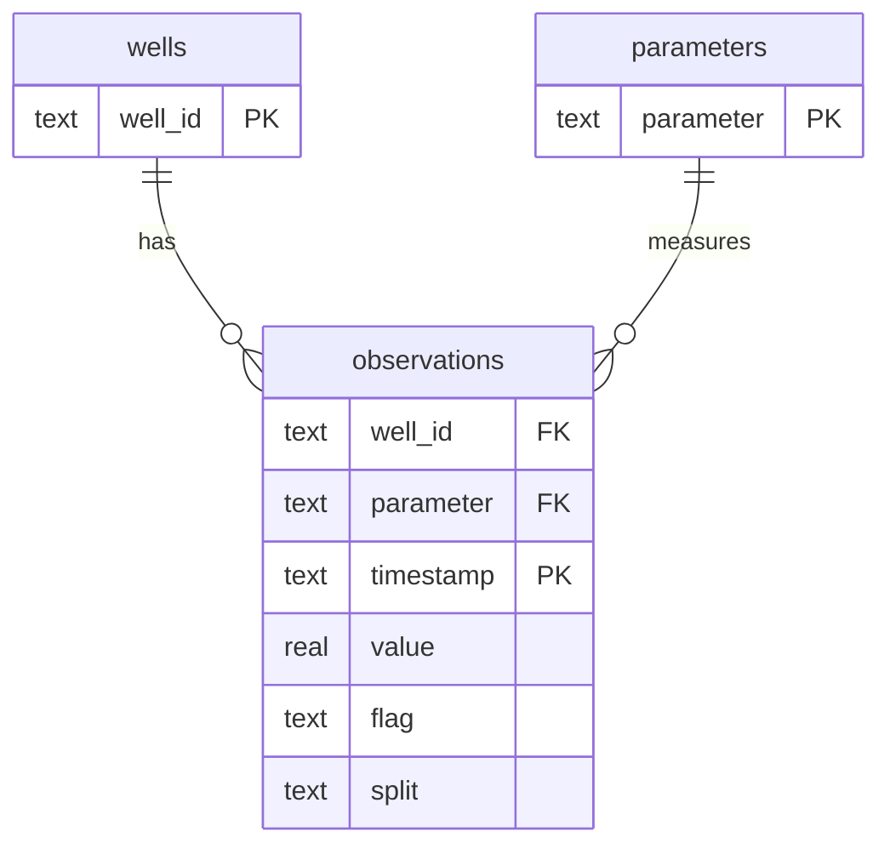

# Database
Dimensions wells(well_id PK, well_type) and parameters(parameter PK, unit); observations PK(well_id, parameter, timestamp), foreign keys to dimensions. Timestamp index supports range queries. Null values are retained. Dimension mappings must be unique. Idempotent observation upserts prevent duplicate inflation. Source split is retained per observation. Flags are source categorical values, not manufactured labels.

Phase 2 query plans: coverage JOIN; monthly aggregates; HAVING flag groups; LAG missing intervals per well/parameter; causal rolling window; flag distribution; type-level summaries; latest observation via ROW_NUMBER. Results return to Pandas.

Phase 2 implementation: eight individual `sql/queries/*.sql` files execute via `pipeline.run_queries`. `flag_types` and `observation_flags` normalize semicolon-separated flags; original `observations.flag` is retained as audit provenance. CLI snapshot replacement clears derived observations/links inside a transaction, leaves dimensions and future analyst-review tables intact. Ordinary `build` calls use idempotent upsert. Rolling SQL explicitly uses 24 preceding **records**, which need not equal 24 clock hours.
